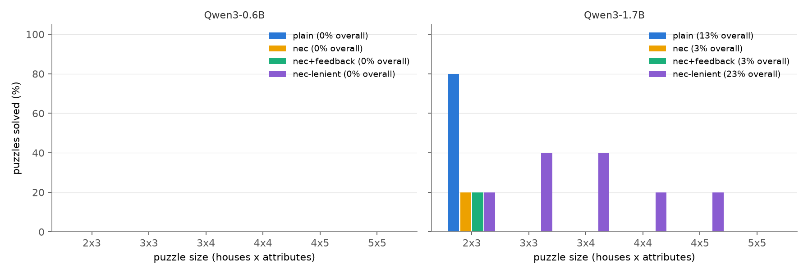

<h1 align="center">zebra-cover</h1>

<p align="center">
  <a href="https://github.com/tatra-labs/zebra-cover/actions/workflows/tests.yml"></a>
  <a href="https://arxiv.org/abs/2611.03641"></a>
  <a href="LICENSE"></a>
  
</p>

<p align="center"><b>Let the language model read the puzzle. Let Knuth solve it.</b><br>
Zebra puzzles through LLM tool calls and an exact-cover solver: a dependency-free, pure-Python version of
NeuralExactCover with its own puzzle generator, and a CPU benchmark on small Qwen3 models.</p>

Language models are bad at Zebra puzzles (*the Swede keeps a dog, the green house is directly left of the
white one...*) because solving them means a long search with backtracking. Exact cover is good at exactly that
search. [*From Natural Language to Exact Cover*](https://arxiv.org/abs/2611.03641) (Skaisgiris, Pammer,
Semmelrock, Ielanskyi, Heisinger, Kobler; November 2026) splits the work between the two:

1. The model **translates** the puzzle into tool calls: `init_zebra` declares the houses and attributes, then
   one call per clue (`clue_property_directly_left_of_property(Color_green, Color_white)`, and so on).
2. An **exact-cover solver** finds every grid consistent with those calls.
3. The solver's verdict goes **back to the model**: no solution means some call says more than its clue; several
   solutions mean some call says less. The model fixes its calls and tries again.

The paper reports 95% of puzzles solved with Qwen3-30B-Instruct this way, against 70.9% when the same model
answers directly. Its [code](https://codeberg.org/bilai-ss25-booleguru-llm/zebrallm) runs on vLLM and a GPU.
**zebra-cover** is the same loop in about 1,000 lines of standard-library Python:

- Knuth's Algorithm C (dancing links with colours), so a clue like "next to" is one primary item with one
  option per pair of houses it allows;
- a generator of fresh puzzles with exactly one solution, phrased like ZebraLogic, each with its gold calls;
- the paper's tool calls, a strict checker with useful error messages, the feedback loop and a grader;
- backends for a local `transformers` model or any OpenAI-compatible endpoint.

```
$ zebra-cover gold --size 3x3 --seed 1
...
## Clues:
1. The person who drives a Kia is directly left of the person who drives a Ford.
2. Peter is somewhere to the right of the Swede.
3. Arnold is the Italian.
4. The person who drives a Kia is directly right of the person who drives a Honda.
5. The person who drives a Ford and Arnold are next to each other.

solver: unique in 0.6 ms

House  Name    Nationality  Car
1      Eric    Swede        Honda
2      Arnold  Italian      Kia
3      Peter   Dane         Ford
```

## Results on two small models, on a CPU

The paper uses 20B to 30B models. With no downloads allowed, this benchmark used the two models already on this
machine: Qwen3-0.6B and Qwen3-1.7B, greedy decoding, thinking off. There were 30 fresh puzzles, 5 at each of six
sizes from 2 houses x 3 attributes up to 5 x 5. A feedback run on 1.7B took 3 to 76 minutes per puzzle on the
CPU, which is why the sample is this small: treat it as evidence about the method's failure modes, not a
leaderboard.

<p align="center"></p>

| model | method | puzzles solved | cell accuracy | 2x3 | 3x3 | 3x4 | 4x4 | 4x5 | 5x5 |
|---|---|---:|---:|---:|---:|---:|---:|---:|---:|
| Qwen3-0.6B | plain (answer directly) | 0% | 30.6% | 0% | 0% | 0% | 0% | 0% | 0% |
| Qwen3-0.6B | tool calls + solver, one shot | 0% | 0% | 0% | 0% | 0% | 0% | 0% | 0% |
| Qwen3-0.6B | tool calls + solver + feedback, 4 rounds | 0% | 0% | 0% | 0% | 0% | 0% | 0% | 0% |
| Qwen3-1.7B | plain (answer directly) | **13.3%** | 43.7% | 80% | 0% | 0% | 0% | 0% | 0% |
| Qwen3-1.7B | tool calls + solver, one shot | 3.3% | 3.3% | 20% | 0% | 0% | 0% | 0% | 0% |
| Qwen3-1.7B | tool calls + solver + feedback, 4 rounds | 3.3% | 5.6% | 20% | 0% | 0% | 0% | 0% | 0% |
| Qwen3-1.7B | the same one-shot replies, lenient reader | **23.3%** | 28.8% | 20% | 40% | 40% | 20% | 20% | 0% |

**As specified, the method loses to plain answering at this scale.** The strict tool-call loop solves 1 of 30
puzzles. Answering directly solves 4 of 30, all of them the smallest size. Feedback did not help: 1.7B solved
no additional puzzle in rounds 2 to 4, and 0.6B never produced a tool call that could be checked. A null, at 0.6B
and 1.7B parameters, says nothing about the paper's 30B result.

**Most of the gap is spelling, not reasoning.** [`experiments/diagnose.py`](experiments/diagnose.py) scores each
first-round clue call from Qwen3-1.7B against the gold call for that clue, by meaning, so `left_of(A, B)` and
`right_of(B, A)` match:

- 54% of clue calls are right as written;
- **80%** are right once near-miss tool names are mapped to the closest real tool. The model writes
  `clue_property_right_of_property` (160 times in all rounds) for `clue_property_right_of`, and
  `clue_property_property` for `clue_property_at_property`;
- only 5 wrong calls are the left/right swap you might expect from a small model.

One wrong name invalidates the whole reply, so 24 of 30 first replies were rejected outright. Reading the same
replies with those aliases (the last row above) solves 7 of 30, including puzzles from 3x3 to 4x5, where plain
answering solves none. That row is exact for a one-shot run with a lenient reader, because the first reply does
not depend on any feedback. It was not a separate run, and the alias table was written after seeing the
replies, so treat it as a diagnosis rather than a result. The strict reader stays the default.

**Feedback rounds broke on bookkeeping.** In 12 of 82 later-round replies, 1.7B re-sent the clue calls but
dropped `init_zebra`, so the checker could not encode them at all. The invented tool names also kept coming
back after the error message had listed the valid ones. 0.6B left out `init_zebra` in 78 of 90 feedback replies.

**A unique solution can still be wrong.** Four encodings from 1.7B had exactly one solution: two first replies
and two reached through feedback. Only one was the right grid. Feedback pushes the model toward *some* unique
encoding, and the solver can check that the calls are consistent, not that they say what the clues say.

Two engineering findings on the way:

- Passing the tools through Qwen3's chat-template tool slot makes the model stop after its first call to wait
  for a result. The paper's format is a single reply containing every call, so the tool schemas go into the
  system prompt as text.
- The pure-Python solver is never the bottleneck. On gold encodings the median is 3.6 ms at 4x4, 14 ms at 5x5 and
  78 ms at 6x6 ([`results/solver_speed.json`](results/solver_speed.json)).

Every reply from both models is stored in [`results/runs/`](results/runs), so all of the above can be re-checked
without a model: `python experiments/report.py` and `python experiments/diagnose.py`.

## Use it

```bash
pip install -e .                    # no dependencies; add [local] for transformers, [experiments] for plots
zebra-cover generate --size 4x4 --seed 3          # a fresh puzzle with one solution
zebra-cover generate --size 4x4 --seed 3 --json   # with the gold tool calls and the solution
zebra-cover gold --size 5x5 --seed 0              # encode from the gold calls, solve, print the grid
zebra-cover encode reply.txt --size 4x4 --seed 3  # check a model's reply against that puzzle
```

The `encode` verdict is one of `unique` (graded against the gold grid), `over` (no solution), `under` (several),
`count` (wrong number of clue calls), `invalid` (with the errors listed) or `none`.

Run the loop against any OpenAI-compatible endpoint (hosted APIs cost money, and nothing in this repository has
done this):

```bash
zebra-cover solve-openai --base-url http://localhost:8000/v1 --model Qwen/Qwen3-30B-A3B-Instruct-2507 \
    --sizes 3x3 4x4 5x5 --per-size 5 --plain
```

Or reproduce the CPU benchmark (resumable, writes `results/runs/*.jsonl`):

```bash
pip install -e ".[local,experiments]"
python experiments/run_llm.py --model Qwen/Qwen3-1.7B --per-size 5
python experiments/report.py && python experiments/diagnose.py
```

From Python:

```python
from zebracover import ExactCover, generate, solve_nec, OpenAIBackend

p = generate(4, 4, seed=3)
att = solve_nec(p, OpenAIBackend("http://localhost:8000/v1", "my-model"), feedback=True, max_rounds=4)
print(att.solved, [r["verdict"] for r in att.rounds])
```

`ExactCover` is usable on its own: primary items must be covered exactly once, secondary items at most once, or
by several options that agree on its colour.

## Differences from the paper

- **Solver.** The paper uses MiniExact; this is a from-scratch Algorithm C in Python. Both solve the same
  encoding.
- **Puzzles.** The paper evaluates on ZebraLogic and its own ZebraExtreme set. These are freshly generated
  ZebraLogic-style puzzles, minimal (every clue is needed) and checked for uniqueness by the solver.
- **Tools.** The same `init_zebra` plus clue calls, with the two "between" clues as separate tools, ten clue
  tools in all.
- **Models.** 0.6B and 1.7B on a CPU instead of 20B to 30B on a GPU. Results are not comparable to the paper's,
  and none of the numbers here contradict it.

## Licence

MIT. The method is due to Skaisgiris et al.; please cite their paper if you use it:

```bibtex
@article{skaisgiris2026exactcover,
  title   = {From Natural Language to Exact Cover: A Neuro-Symbolic Approach to Zebra Puzzles},
  author  = {Skaisgiris, Paulius and Pammer, Thomas and Semmelrock, Veronika and Ielanskyi, Mykyta and
             Heisinger, Maximilian and Kobler, Erich},
  journal = {arXiv preprint arXiv:2611.03641},
  year    = {2026}
}
```
